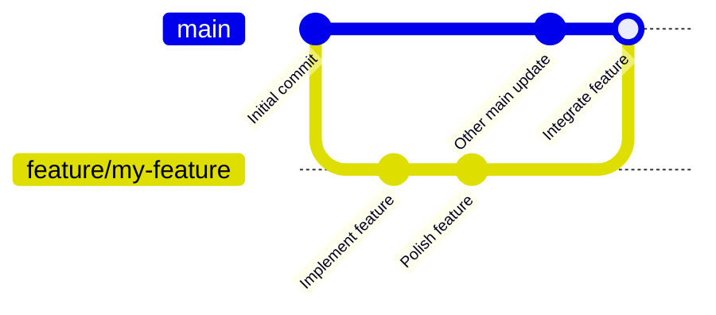
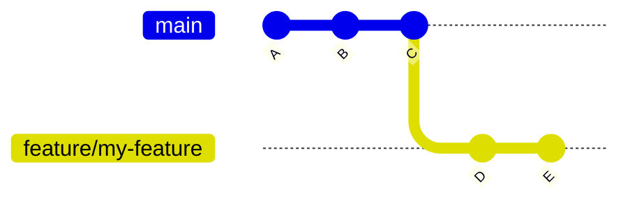
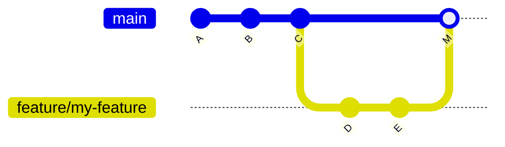
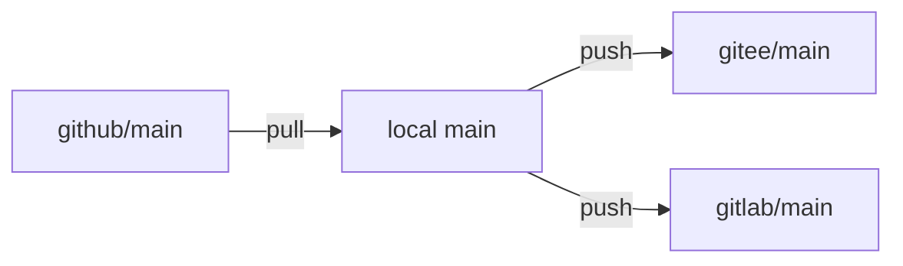

## Quick Reference: Everyday Commands

This example uses `feature/my-feature`. Assume `github` is the primary remote for pull requests, while `gitee` and `gitlab` are mirrors.

```bash
# 1. Create a feature branch from main
git switch main
git switch -c feature/my-feature

# 2. Develop and commit
git add .
git commit -m "feat: implement my feature"

# 3. Push the feature branch to the primary remote
git push -u github feature/my-feature

# 4. Create a PR on GitHub: feature/my-feature -> main
#    Review the changes and merge the PR

# 5. After merging, sync GitHub's main to your local main
git switch main
git pull github main

# 6. Push the updated main to the other remotes
git push gitee main
git push gitlab main

# 7. Delete the merged local feature branch
git branch -d feature/my-feature

# 8. Optionally delete feature branches from remotes
git push github --delete feature/my-feature
git push gitee --delete feature/my-feature
git push gitlab --delete feature/my-feature
```

> Confirm that the PR is merged and your local main is synchronized before cleaning up branches. Adjust remote and branch names to match your setup.

## 1. Why use feature branches?

Treat `main` as the primary line of development and keep it in a reasonably stable, runnable state. For each new feature, create a separate branch from main. Make changes, test, and commit on that branch; merge it back into main when it is ready.

This isolates unfinished work from the main line and makes changes easier to review, track, and revert.

### Branch diagram



## 2. Create and name a branch

Check your working tree and current branch:

```bash
git status
git branch
```

If main is in a suitable state, create and switch to a new branch:

```bash
git switch main
git switch -c feature/my-feature
```

`git switch -c` combines branch creation and switching; it is equivalent to creating the branch with `git branch` and then switching to it.

### Branch naming

The slash in `feature/my-feature` is not special Git syntax for feature behavior. It is a naming convention that helps group branches. `feature-my-feature` works just as well. When using slash-based names, avoid creating both a branch named `feature` and branches such as `feature/...`, because the refs would conflict.

Common prefixes:

| Prefix | Purpose | Example |
|---|---|---|
| `feature/` | New functionality | `feature/new-layout` |
| `fix/` | Bug fixes | `fix/navbar-bug` |
| `docs/` | Documentation | `docs/git-guide` |
| `refactor/` | Refactoring | `refactor/theme-config` |
| `experiment/` | Experiments | `experiment/new-style` |

## 3. Develop and commit on the feature branch

Once you're on the feature branch, edit the project normally. You can commit at different stages:

```bash
git add .
git commit -m "feat: add layout structure"

git add .
git commit -m "feat: implement responsive layout"

git add .
git commit -m "test: verify layout behavior"
```

Each commit belongs to the current branch's history. Use clear commit messages, optionally with prefixes such as `feat:`, `fix:`, or `docs:`.

## 4. View a local Git graph

Git can display a text-based graph without any additional software:

```bash
git log --graph --oneline --decorate --all
```

You can define a global alias and then run `git graph`:

```bash
git config --global alias.graph "log --graph --oneline --decorate --all"
```

If you use VS Code, the **Git Graph** extension provides a graphical view of commits, branches, and merges.

## 5. Push the feature branch

Push for the first time and set the upstream:

```bash
git push -u github feature/my-feature
```

Here, `github` is the remote name and `feature/my-feature` is the branch. `-u` (`--set-upstream`) links the local branch to its remote-tracking branch. Subsequent pushes and pulls on that branch can usually use `git push` and `git pull` without specifying the remote and branch.

If you want the feature branch on multiple remotes, push it separately:

```bash
git push gitee feature/my-feature
git push gitlab feature/my-feature
```

## 6. Merge the feature into main

After development and review, merge the feature branch into main. Git merges the specified branch into the **currently checked-out branch**, so switch to main first:

```bash
git switch main
git merge feature/my-feature
```

### Fast-forward merge

If main has not received independent commits during feature development, Git may move main forward to the feature's latest commit. This is a fast-forward:



```text
A -- B -- C -- D -- E
           ^         ^
          main     feature
```

After the merge, main points to E, without requiring an additional merge commit.

### Non-fast-forward / merge commit

If both main and the feature branch have their own commits, Git generally creates a merge commit to record how the histories were integrated.



```text
          D -- E ----\
         /            \
A -- B -- C -- M -----+  main
         \
          (main was at C, the branch point)
```

Even when a fast-forward is possible, you can force a merge commit with `--no-ff` to make the feature merge visible in history:

```bash
git merge --no-ff feature/my-feature
```

Choose whether to use `--no-ff` based on how you prefer your project history to look.

## 7. Merge conflicts

If main and the feature branch modify the same part of a file, Git may be unable to merge automatically. It marks the conflict in the file:

```text
<<<<<<< HEAD
Content from main
=======
Content from feature
>>>>>>> feature/my-feature
```

Edit the file to choose or combine the changes, remove the conflict markers, then:

```bash
git add <conflicted-file>
git commit
```

To abort an unfinished merge:

```bash
git merge --abort
```

A conflict is not a Git failure; it means a developer must decide how to combine the changes.

## 8. Pull Requests: You can open a PR within the same repository

A Pull Request (PR) is not a Git command. It is a review-and-merge workflow offered by platforms such as GitHub, GitLab, and Gitee. At its core, a PR proposes merging changes from one branch into another.

**You can open a PR within the same account and the same repository.** You do not need another account or a fork.

For example, the same GitHub repository contains:

- `main`: the target branch (Base)
- `feature/my-feature`: the source branch (Head / Compare)

When creating the PR, select:

```text
Base:    main
Compare: feature/my-feature
```

This requests that the feature branch's changes be merged into main. You can review the diff, edit the PR description, check automated tests, and merge it yourself, provided the repository's rules allow it. If branch protection requires approval from another person, that rule must still be satisfied.

### Why use PRs as a solo developer?

- **Review the diff:** Inspect the changes before merging.
- **Keep main stable:** Avoid merging unreviewed or unfinished work directly into main.
- **Document features:** PR titles, descriptions, commits, and changed files provide a record.
- **Run automated checks:** Tests, builds, and GitHub Actions workflows can run at PR time.

## 9. PR merge strategies

Platforms commonly offer several merge strategies:

| Strategy | Description |
|---|---|
| Merge commit | Preserves branch commits and records a merge commit. |
| Squash and merge | Combines the feature's commits into one commit before merging. |
| Rebase and merge | Replays commits onto the target history, generally without a conventional merge commit. |

These strategies produce different commit histories. In a multi-remote setup, take particular care: if GitHub uses Squash or Rebase Merge, its main history may differ from the original feature branch history. After merging, treat the primary remote's main as the source of truth. Sync it locally before pushing it to other remotes; don't push the old feature branch directly into another remote's main.

## 10. Multiple remotes: how do the other remotes sync after a PR?

Suppose the same local project has three remotes:

| Remote | Role |
|---|---|
| `github` | Primary platform for PRs, review, and merging |
| `gitee` | Mirror |
| `gitlab` | Mirror |

Merging a PR on GitHub updates the relevant branch on GitHub only. It does not automatically update Gitee or GitLab.

We recommend using GitHub as the primary merge platform. After the PR is merged:

```bash
# Switch to local main
git switch main

# Sync the merged main from GitHub to local
git pull github main

# Push the synchronized main to the other remotes
git push gitee main
git push gitlab main
```

Now all three remotes' main branches can be synchronized to the same merge result.



```text
local main  <--- pull --- github/main (PR merged)
   |
   +---- push ----> gitee/main
   |
   +---- push ----> gitlab/main
```

### Should you create PRs on all three platforms?

You can, but it is usually unnecessary for a solo project. Separate PRs on each platform increase the cost of review, merging, and history management.

A simpler approach:

- Choose one platform as the primary place for PRs and merges.
- Use the other remotes as synchronized mirrors.
- After merging the PR, pull the primary remote's main locally and push it to the other remotes.

## 11. Clean up branches after merging

After the merge is complete and main is synchronized, delete the local feature branch:

```bash
git branch -d feature/my-feature
```

If you no longer need the remote feature branches, delete them individually:

```bash
git push github --delete feature/my-feature
git push gitee --delete feature/my-feature
git push gitlab --delete feature/my-feature
```

Deleting a branch reference does not delete commits already merged into main. `git branch -d` is the safer deletion option: Git will generally refuse to delete a branch it considers unmerged.

## 12. Summary

For a solo project, a simple **main + feature branches + Pull Requests** workflow is usually enough:

1. Keep `main` reasonably stable.
2. Create a separate `feature/...` branch for each new feature.
3. Develop, test, and commit on the feature branch.
4. Push the feature to the primary remote.
5. Open a PR, review the diff, and merge it into main.
6. After merging, pull the primary remote's main into local main.
7. Push the synchronized main to the other remotes.
8. Delete the completed feature branch.

You don't need a complicated Git Flow or an additional long-lived `develop` branch for this workflow. It works well for solo projects, open-source themes, and small codebases.