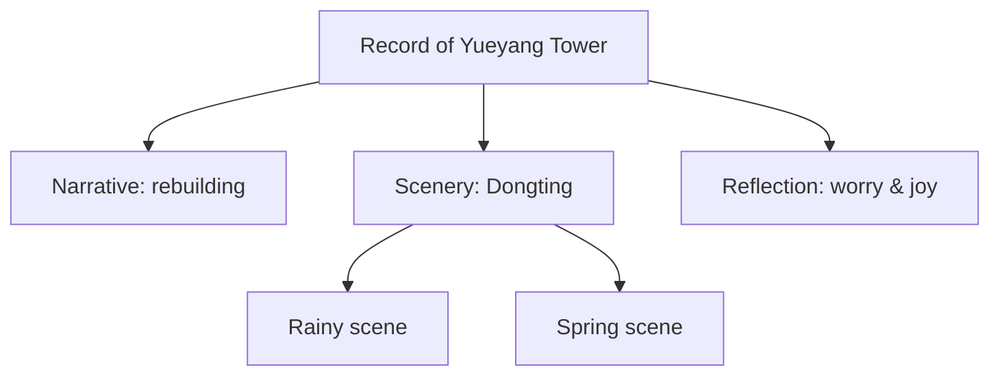

# Record of Yueyang Tower (excerpt, from *Guwen Guanzhi*)

An excerpt from Fan Zhongyan's "Record of Yueyang Tower", used to demonstrate headings, paragraphs, blockquotes, lists, tables, flowcharts, and images.

## Part 1 · Narration

> In the fourth year of Qingli, Teng Zijing was banished as governor of Baling Commandery. The following year, governance was smooth and the people harmonious; all neglected affairs were revived. He therefore rebuilt the Yueyang Tower, enlarged its original scale, and had the prose and verse of the Tang sages and his contemporaries inscribed upon it. He charged me to compose a record for it.

## Part 2 · Scenery

When I surveyed the excellences of Baling, they all lie in the Dongting Lake:

1. It **embraces distant mountains and swallows the Long River**, vast and boundless;
2. In the morning sun and evening shade, its atmosphere changes in a thousand ways—such is the grand view of the Yueyang Tower.

In spring, when the weather is bright and the lake is calm, heaven and water reflect one hue, stretching boundless and clear.

---

## Key Words

| Word | Meaning | Example |
|------|---------|---------|
| 谪守 | exiled to govern | 滕子京谪守巴陵郡 |
| 属 | to entrust | 属予作文以记之 |
| 浩浩汤汤 | vast and mighty | 浩浩汤汤，横无际涯 |

## Article Structure (Mermaid)

## Image rendering (render-image)

## Further reading

- Link (render-link): [Hugo documentation](https://gohugo.io/)
- Chinese counterpart: `zh-hans/posts/guwen-yueyanglou.md`