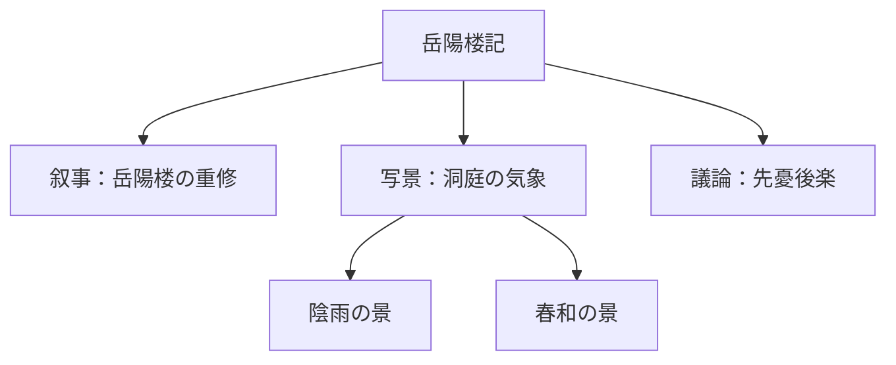

# 「岳陽楼記」抜粋（『古文観止』）

本稿は范仲淹『岳陽楼記』の抜粋で、見出し階層、段落、引用、リスト、表、フローチャート、画像などの機能をデモします。

## 第一段・叙事

> 慶暦四年春、滕子京の岳陽楼に諭せらる。越ゆること明年、政通じ人和し、百廃俱に興る。乃ち岳陽楼を重修し、其の旧制を増し、唐の賢人今人の詩賦を其の上に刻す。属に子に作文して之を記せしむ。

## 第二段・写景

予観の夫れ巴陵の勝状、洞庭の一湖に在り。

1. **遠山を衔み、長江を吞む**、浩浩湯湯として、横は涯際無し；
2. 朝暉夕陰、気象万端、此れ則ち岳陽楼の大観なり。

至る若し春和景明、波瀾驚かず、上わ下天光、一碧の頃。——これは写景であると同時に、作者の心境の写しでもあります。

---

## 重点語句の対照表

| 語 | 意味 | 例文 |
|----|------|------|
| 諭守 | 罪により左遷されて地方官となる | 滕子京、巴陵郡に諭守す |
| 属 | 「嘱」に同じ、託す | 属予作文以記之 |
| 浩浩湯湯 | 水勢が雄大である | 浩浩湯湯、横に涯際無し |

## 文章構成図（Mermaid フローチャート）

## 画像デモ（render-image）

## 関連リンク

- 関連リンク（render-link）：[Hugo 公式ドキュメント](https://gohugo.io/)
- 英語対訳版：`en/posts/guwen-yueyanglou.md`