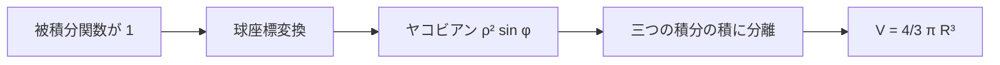

# 三重積分：球座標による球の体積の導出

このページは、数式（KaTeX：行内・ブロック）がサンプルコンテンツでどのように表示されるかを示します。

## 問題設定と変数変換

球体を $B = \{ (x,y,z) : x^2 + y^2 + z^2 \le R^2 \}$ とします。球座標に変換します。

$$
x = \rho\sin\varphi\cos\theta,\quad
y = \rho\sin\varphi\sin\theta,\quad
z = \rho\cos\varphi
$$

ここで $\rho \in [0, R]$、$\varphi \in [0, \pi]$、$\theta \in [0, 2\pi]$ であり、ヤコビアンは $\rho^2\sin\varphi$ です。

球の体積は「1 の三重積分」として求められます。

$$
V = \iiint_{B} 1\,dV
   = \int_0^{2\pi}\int_0^{\pi}\int_0^{R}\rho^2\sin\varphi\,
     d\rho\,d\varphi\,d\theta
$$

## 変数分離

被積分関数が分離可能なので、三重積分は三つの一重積分の積になります。

$$
\begin{aligned}
V
&= \left(\int_0^{2\pi} d\theta\right)
   \left(\int_0^{\pi}\sin\varphi\, d\varphi\right)
   \left(\int_0^{R}\rho^2\, d\rho\right)\\
&= (2\pi)(2)\left(\frac{R^3}{3}\right)
   = \frac{4}{3}\pi R^3
\end{aligned}
$$

よって、球の体積の公式は次のようになります。

$$
V = \frac{4}{3}\pi R^3 \quad \checkmark
$$

## 導出フロー（Mermaid フローチャート）



## 数値検証（Python コードブロック）

```python
import numpy as np
from scipy import integrate

R = 1.0
f = lambda z, y, x: 1.0

# 球の範囲で 1 の数値三重積分
volume, _ = integrate.tplquad(
    f,
    -R, R,
    lambda x: -np.sqrt(R**2 - x**2),      lambda x: np.sqrt(R**2 - x**2),
    lambda x, y: -np.sqrt(R**2 - x**2 - y**2),
    lambda x, y:  np.sqrt(R**2 - x**2 - y**2),
)
print(volume)            # 4.18879...
print(4 / 3 * np.pi * R**3)   # 4.18879...  一致
```