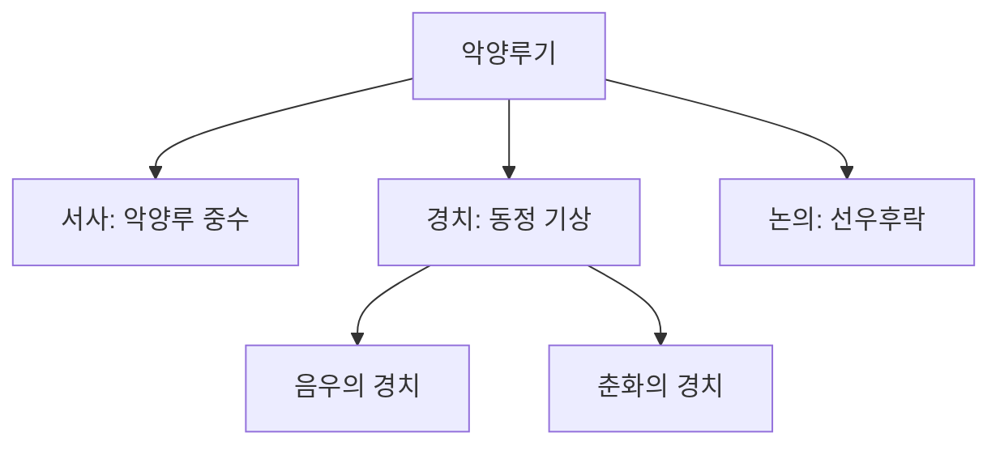

# '악양루기' 발췌(《고문관지》)

본문은 범중엄 《악양루기》의 발췌로, 제목 계층, 단락, 인용, 목록, 표, 순서도, 이미지 등의 기능을 시연합니다.

## 제1단·서사

> 경력 4년 봄, 등자경이 파링군으로 유배되었다. 이듬해 정사가 통해 백성이 화합하고 모든 폐지된 일이 다시 일어났다. 이에 악양루를 중수하고 그 옛 체제를 확장하여 당현과 명사들의 시부를 그 위에 새겼다.

## 제2단·경치 묘사

내가 보건대 파릉의 경치는 동정호 하나에 있다.

1. **먼 산을 머금고 장강을 삼키니**, 호탕하여 아득하여 끝이 없다;
2. 아침엔 볕이 비치고 저녁엔 그늘이 지니, 기상이 만 가지이며, 이것이 곧 악양루의 큰 경치다.

이처럼 봄이 화창하고 경치가 밝으면, 물결이 일지 않고, 하늘과 강물이 하나로 푸르러 만 이랑을 이룬다。——이것은 경치 묘사인 동시에 저자의 마음이 반영된 것입니다.

---

## 주요 단어 대조표

| 단어 | 뜻 | 예문 |
|----|------|------|
| ?守 | 죄를 지어 좌천되어 지방 관리가 됨 | 滕子京?守巴陵郡 |
| 屬 | '囑'과 같음, 부탁함 | 屬予作文以記之 |
| 浩浩湯湯 | 물길이 거대함 | 浩浩湯湯, 橫無際涯 |

## 글의 구조도(Mermaid 순서도)

## 이미지 시연(render-image)

## 관련 링크

- 관련 링크(render-link): [Hugo 공식 문서](https://gohugo.io/)
- 영어 대역판: `en/posts/guwen-yueyanglou.md`