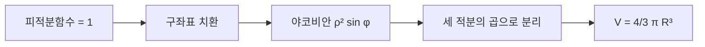

# 삼중적분: 구좌표로 구의 부피 유도

이 페이지는 수식(KaTeX: 인라인·블록)이 예시 콘텐츠에서 어떻게 표시되는지 보여줍니다.

## 문제 설정과 변수 치환

구를 $B = \{ (x,y,z) : x^2 + y^2 + z^2 \le R^2 \}$라 합시다. 구좌표로 바꿉니다.

$$
x = \rho\sin\varphi\cos\theta,\quad
y = \rho\sin\varphi\sin\theta,\quad
z = \rho\cos\varphi
$$

여기서 $\rho \in [0, R]$、$\varphi \in [0, \pi]$、$\theta \in [0, 2\pi]$이고, 야코비안은 $\rho^2\sin\varphi$입니다.

구의 부피는 "1에 대한 삼중적분"으로 구합니다.

$$
V = \iiint_{B} 1\,dV
   = \int_0^{2\pi}\int_0^{\pi}\int_0^{R}\rho^2\sin\varphi\,
     d\rho\,d\varphi\,d\theta
$$

## 변수 분리

피적분함수가 분리 가능하므로, 삼중적분은 세 개의 일중적분의 곱이 됩니다.

$$
\begin{aligned}
V
&= \left(\int_0^{2\pi} d\theta\right)
   \left(\int_0^{\pi}\sin\varphi\, d\varphi\right)
   \left(\int_0^{R}\rho^2\, d\rho\right)\\
&= (2\pi)(2)\left(\frac{R^3}{3}\right)
   = \frac{4}{3}\pi R^3
\end{aligned}
$$

따라서 구의 부피 공식은 다음과 같습니다.

$$
V = \frac{4}{3}\pi R^3 \quad \checkmark
$$

## 유도 흐름(Mermaid 순서도)



## 수치 검증(Python 코드 블록)

```python
import numpy as np
from scipy import integrate

R = 1.0
f = lambda z, y, x: 1.0

# 구의 범위에서 1의 수치 삼중적분
volume, _ = integrate.tplquad(
    f,
    -R, R,
    lambda x: -np.sqrt(R**2 - x**2),      lambda x: np.sqrt(R**2 - x**2),
    lambda x, y: -np.sqrt(R**2 - x**2 - y**2),
    lambda x, y:  np.sqrt(R**2 - x**2 - y**2),
)
print(volume)            # 4.18879...
print(4 / 3 * np.pi * R**3)   # 4.18879...  일치
```