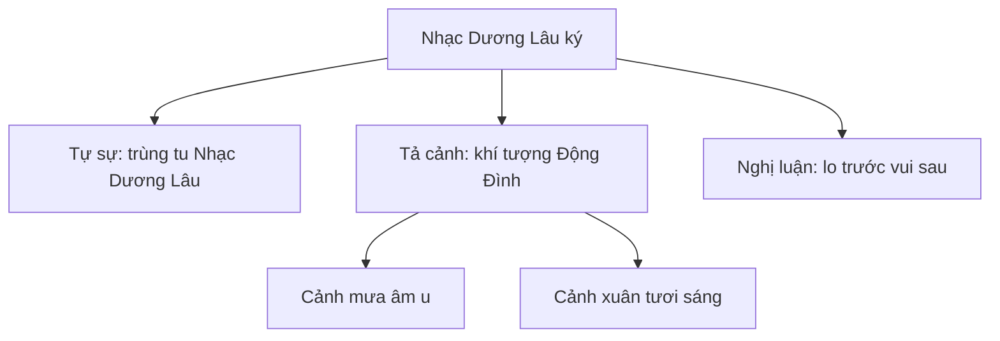

# Trích đoạn 'Nhạc Dương Lâu ký' (*Cổ văn quan chỉ*)

Bài này trích từ *Nhạc Dương Lâu ký* của Phạm Trọng Yêm, minh họa cấp độ tiêu đề, đoạn văn, trích dẫn, danh sách, bảng, lưu đồ và hình ảnh.

## Đoạn 1·Tự sự

> Khánh Lịch năm thứ tư mùa xuân, Đằng Tử Kinh bị biếm làm quan ở Ba Lăng. Năm sau, chính sự thông thuận, nhân dân hòa hợp, trăm việc phế bỏ đều hưng khởi, bèn trùng tu Nhạc Dương Lâu, mở rộng quy mô cũ, khắc thơ phú của danh sĩ xưa nay lên tường. Sai tôi làm bài ký.

## Đoạn 2·Tả cảnh

Ta xem thắng cảnh Ba Lăng, chẳng qua ở hồ Động Đình:

1. **Ngậm núi xa, nuốt Trường Giang**, sóng trào mênh mông, ngang trời không bờ;
2. Rạng chiều sớm tối, khí tượng muôn vàn, ấy chính là cảnh lớn của Nhạc Dương Lâu.

Chí như xuân hòa cảnh sáng, sóng lặng, trên dưới không gian trong một màu xanh muôn dặm.—Đây vừa là tả cảnh, vừa là sự phản chiếu tâm cảnh tác giả.

---

## Đối chiếu từ ngữ trọng điểm

| Từ | Nghĩa | Ví dụ |
|----|------|------|
| ?守 | Bị biếm quan vì tội, làm quan địa phương | 滕子京?守巴陵郡 |
| 屬 | Cùng với '囑' (dặn dò) | 屬予作文以記之 |
| 浩浩湯湯 | Thế nước mênh mông | 浩浩湯湯, 橫無際涯 |

## Sơ đồ cấu trúc bài (lưu đồ Mermaid)

## Hình ảnh minh họa (render-image)

## Liên kết mở rộng

- Liên kết liên quan (render-link): [Tài liệu Hugo chính thức](https://gohugo.io/)
- Bản dịch tiếng Anh: `en/posts/guwen-yueyanglou.md`