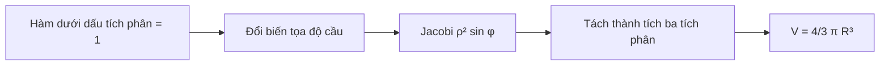

# Tích phân ba lớp: thể tích khối cầu bằng tọa độ cầu

Trang này minh họa cách công thức toán (KaTeX: inline và block) xuất hiện trong nội dung mẫu.

## Thiết lập bài toán và đổi biến

Cho khối cầu $B = \{ (x,y,z) : x^2 + y^2 + z^2 \le R^2 \}$. Đổi sang tọa độ cầu:

$$
x = \rho\sin\varphi\cos\theta,\quad
y = \rho\sin\varphi\sin\theta,\quad
z = \rho\cos\varphi
$$

với $\rho \in [0, R]$、$\varphi \in [0, \pi]$、$\theta \in [0, 2\pi]$. Định thức Jacobi là $\rho^2\sin\varphi$.

Thể tích khối cầu được tính bằng "tích phân ba lớp của 1":

$$
V = \iiint_{B} 1\,dV
   = \int_0^{2\pi}\int_0^{\pi}\int_0^{R}\rho^2\sin\varphi\,
     d\rho\,d\varphi\,d\theta
$$

## Tách biến

Vì hàm dưới dấu tích phân tách được, tích phân ba lớp trở thành tích của ba tích phân đơn:

$$
\begin{aligned}
V
&= \left(\int_0^{2\pi} d\theta\right)
   \left(\int_0^{\pi}\sin\varphi\, d\varphi\right)
   \left(\int_0^{R}\rho^2\, d\rho\right)\\
&= (2\pi)(2)\left(\frac{R^3}{3}\right)
   = \frac{4}{3}\pi R^3
\end{aligned}
$$

Do đó công thức thể tích khối cầu là

$$
V = \frac{4}{3}\pi R^3 \quad \checkmark
$$

## Quy trình suy luận (lưu đồ Mermaid)



## Kiểm chứng số (khối mã Python)

```python
import numpy as np
from scipy import integrate

R = 1.0
f = lambda z, y, x: 1.0

# Tích phân ba lớp số của 1 trong khối cầu
volume, _ = integrate.tplquad(
    f,
    -R, R,
    lambda x: -np.sqrt(R**2 - x**2),      lambda x: np.sqrt(R**2 - x**2),
    lambda x, y: -np.sqrt(R**2 - x**2 - y**2),
    lambda x, y:  np.sqrt(R**2 - x**2 - y**2),
)
print(volume)            # 4.18879...
print(4 / 3 * np.pi * R**3)   # 4.18879...  khớp
```