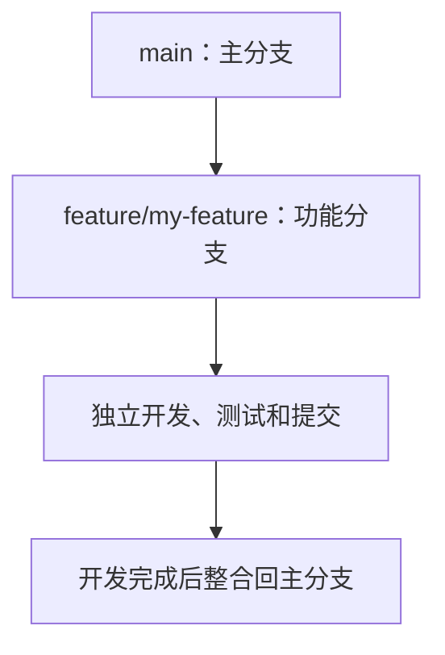
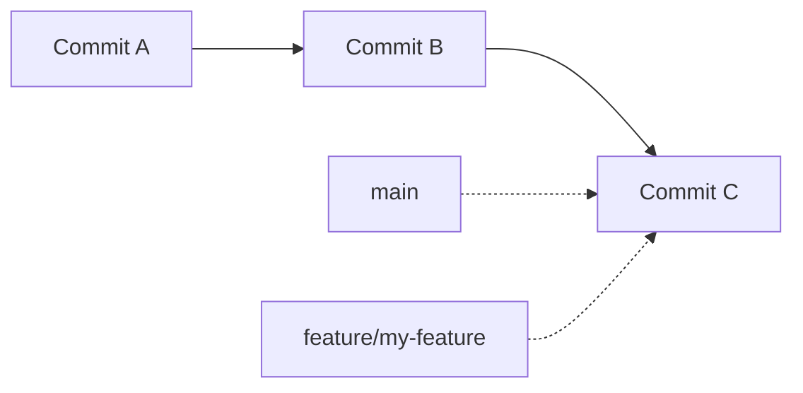
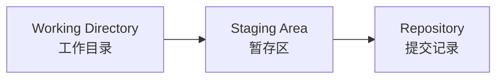
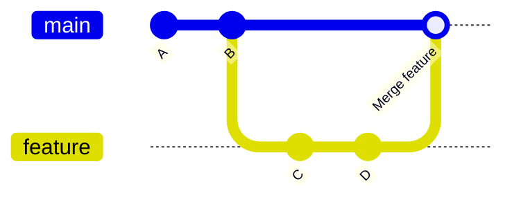
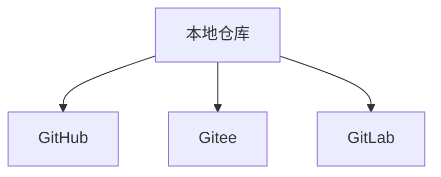
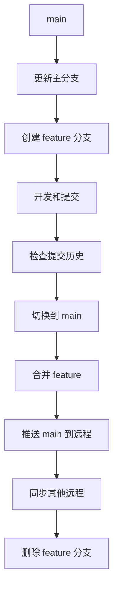

# Git 分支开发工作流：从创建分支到合并

## 日常命令速查

假设我们正在开发一个名为 `my-feature` 的功能，采用 `main` 主分支和 `feature/my-feature` 功能分支。

```bash
# 1. 切换到主分支
git switch main

# 2. 更新主分支
git pull github main

# 3. 创建并切换到功能分支
git switch -c feature/my-feature

# 4. 查看当前分支
git branch --show-current

# 5. 开发完成后提交
git add .
git commit -m "feat: implement my feature"

# 6. 查看提交历史
git log --graph --oneline --decorate --all

# 7. 合并功能分支到主分支
git switch main
git merge feature/my-feature

# 8. 推送主分支到远程
git push github main

# 9. 删除已经合并的本地功能分支
git branch -d feature/my-feature

# 10. 删除远程功能分支（如果存在）
git push github --delete feature/my-feature
```

> 本文以 `github` 作为示例远程仓库名称。实际使用时，请将其替换为自己的 remote 名称。

---

## 1. 为什么需要 Git 分支？

在使用 Git 管理项目时，我们通常会有一个主分支，用来保存项目相对稳定的代码。

如果所有开发工作都直接在主分支上进行，那么当我们开发新功能、修改 Bug 或试验新方案时，主分支可能随时处于不稳定状态。

Git 分支（Branch）可以让我们在不直接影响主线代码的情况下，独立开展开发工作。

例如：

- `main`：保存相对稳定的项目版本。
- `feature/...`：开发新功能。
- `fix/...`：修复问题。
- `docs/...`：修改文档。
- `experiment/...`：进行试验性开发。

### 分支的基本结构



纯文本示意：

```text
main
  |
  +-- feature/my-feature
        |
        +-- 独立开发
        +-- 独立提交
        +-- 独立测试
```

功能分支并不是复制一份完整的项目文件夹。Git 分支本质上是指向某个提交的引用。创建分支通常非常轻量，因此我们可以根据开发任务创建多个分支。

---

## 2. Git 分支是什么？

Git 中的分支可以理解为一个指向提交记录的指针。

当我们提交代码时，Git 会生成一个新的提交记录，而当前分支的指针会移动到这个新的提交上。

例如：

```text
A---B---C
        ^
       main
```

这里：

- `A`、`B`、`C` 是提交记录。
- `main` 是分支名称。
- `main` 指向提交 `C`。

如果创建一个新分支：

```bash
git branch feature/my-feature
```

那么此时：

```text
A---B---C
        ^
       main
        \
         feature/my-feature
```

两个分支都指向同一个提交 `C`。

这并不意味着 Git 复制了两份代码。它只是创建了一个新的分支引用。

### 分支和提交的关系



分支名称可以改变，提交记录本身则是 Git 历史中的对象。

理解这一点，有助于理解后续的分支切换、提交、合并和删除。

---

## 3. 创建和切换分支

Git 中有两种常见的分支创建方式。

### 3.1 创建分支

```bash
git branch feature/my-feature
```

这条命令只创建分支，并不会自动切换到该分支。

### 3.2 切换分支

```bash
git switch feature/my-feature
```

切换后，我们的工作环境就对应这个分支。

### 3.3 创建并立即切换

更常用的方式是：

```bash
git switch -c feature/my-feature
```

这条命令相当于：

```bash
git branch feature/my-feature
git switch feature/my-feature
```

### 3.4 确认当前分支

```bash
git branch
```

输出可能是：

```text
  main
* feature/my-feature
```

星号 `*` 表示当前所在的分支。

也可以直接使用：

```bash
git branch --show-current
```

输出：

```text
feature/my-feature
```

---

## 4. 分支命名规范

Git 并没有强制要求分支使用某种命名方式，但在开发中通常会使用前缀区分不同类型的工作。

| 分支前缀 | 用途 | 示例 |
|---|---|---|
| `feature/` | 开发新功能 | `feature/dark-mode` |
| `fix/` | 修复问题 | `fix/pagination-error` |
| `docs/` | 文档修改 | `docs/installation-guide` |
| `refactor/` | 代码重构 | `refactor/header-layout` |
| `test/` | 测试相关 | `test/search-module` |
| `experiment/` | 实验性开发 | `experiment/new-search` |

例如：

```text
feature/dark-mode
feature/user-login
fix/image-loading
docs/readme-update
refactor/navigation
experiment/new-layout
```

### 为什么使用斜杠 `/`？

`feature/dark-mode` 中的斜杠只是命名约定。

Git 内部的分支引用通常以类似以下形式保存：

```text
refs/heads/feature/dark-mode
```

这种层级结构让分支名称更容易分类和管理。

需要注意，不要同时创建：

```text
feature
feature/dark-mode
```

因为 Git 的引用存储结构存在层级冲突，可能无法同时建立这两个名称。

---

## 5. 在功能分支中开发和提交

创建功能分支后，我们就可以在该分支中进行开发。

例如：

```bash
git switch -c feature/dark-mode
```

修改项目文件，完成一部分工作后：

```bash
git add .
git commit -m "feat: add dark mode"
```

### 5.1 Git 提交的基本过程

Git 的提交过程可以简单理解为：



纯文本：

```text
修改文件
   |
   v
git add
   |
   v
暂存区
   |
   v
git commit
   |
   v
Git 提交记录
```

常用命令：

```bash
# 查看文件状态
git status

# 将修改加入暂存区
git add .

# 提交
git commit -m "feat: add dark mode"

# 查看提交历史
git log
```

### 5.2 为什么要使用暂存区？

Git 的暂存区（Staging Area）允许我们选择哪些修改要进入下一次提交。

例如，一个项目中同时修改了三个文件：

```text
index.html
style.css
README.md
```

我们可能只想提交 `index.html` 和 `style.css`：

```bash
git add index.html
git add style.css
git commit -m "feat: add page layout"
```

这样，`README.md` 的修改就不会进入此次提交。

暂存区使提交内容更加可控。

### 5.3 提交信息的常见格式

可以采用简单的前缀规范：

| 前缀 | 含义 |
|---|---|
| `feat:` | 新功能 |
| `fix:` | Bug 修复 |
| `docs:` | 文档 |
| `refactor:` | 重构 |
| `test:` | 测试 |
| `style:` | 格式调整 |
| `chore:` | 项目维护 |

示例：

```bash
git commit -m "feat: add dark mode"
git commit -m "fix: correct pagination logic"
git commit -m "docs: update installation guide"
```

提交信息应该简洁地描述此次提交做了什么。

---

## 6. 查看分支和提交历史

开发过程中，我们经常需要查看当前分支、其他分支和提交记录。

### 6.1 查看分支列表

```bash
git branch
```

查看所有本地分支：

```bash
git branch
```

查看远程分支：

```bash
git branch -r
```

查看本地和远程分支：

```bash
git branch -a
```

### 6.2 查看提交历史

```bash
git log
```

更简洁的方式：

```bash
git log --oneline
```

### 6.3 查看分支图

```bash
git log --graph --oneline --decorate --all
```

参数说明：

| 参数 | 作用 |
|---|---|
| `--graph` | 以字符图形显示提交关系 |
| `--oneline` | 每个提交显示为一行 |
| `--decorate` | 显示分支、标签等引用信息 |
| `--all` | 显示所有分支的提交 |

示例：

```text
* 9ab12cd (feature/dark-mode) feat: add dark mode
* 3cd45ef feat: add theme toggle
| * 7ef89ab (main) docs: update README
|/
* 1a2b3c4 initial commit
```

### 6.4 创建 Git 命令别名

如果经常查看提交图，可以设置全局别名：

```bash
git config --global alias.graph "log --graph --oneline --decorate --all"
```

之后执行：

```bash
git graph
```

就可以查看提交图。

### 6.5 使用 VS Code 查看

VS Code 可以通过扩展查看 Git 提交历史。

推荐扩展：

**Git Graph**

它可以图形化展示：

- 提交历史。
- 分支关系。
- 合并记录。
- Commit 信息。
- 分支切换。
- 部分 Git 操作。

对于初学者来说，图形化工具有助于理解分支与提交之间的关系。

---

## 7. 合并分支

完成一个功能后，通常需要把功能分支上的修改整合回主分支。

假设我们有：

```text
main
feature/my-feature
```

功能开发已经完成，现在希望把 `feature/my-feature` 合并到 `main`。

### 7.1 切换回主分支

```bash
git switch main
```

### 7.2 执行合并

```bash
git merge feature/my-feature
```

这条命令的意思是：

将 `feature/my-feature` 中的提交和修改整合到当前分支。

<text weight="medium">注意：合并目标是当前所在分支。</text>

如果当前在 `main`：

```bash
git merge feature/my-feature
```

就意味着将功能分支合入 `main`。

### 7.3 分支合并示意



纯文本：

```text
main:      A---B-------M
               \      /
feature:        C---D
```

这里：

- `A`、`B` 是主分支已有提交。
- `C`、`D` 是功能分支的提交。
- `M` 是合并提交。

合并完成后，功能分支的修改已经整合到 `main` 中。

---

## 8. Fast-forward 和 Merge Commit

Git 合并时可能采用不同的方式。

### 8.1 Fast-forward（快进合并）

如果主分支在功能分支创建之后没有产生新的独立提交，Git 可以直接将主分支指针移动到功能分支的最新提交。

例如：

```text
合并前：

main:      A---B
               \
feature:        C---D
```

如果 `main` 没有继续向前发展，那么合并后：

```text
合并后：

main:      A---B---C---D
```

Git 只需要移动 `main` 的指针。

这就是 Fast-forward。

### 8.2 Merge Commit（合并提交）

如果主分支和功能分支都产生了新的提交，双方历史发生分叉，就可能需要合并提交。

```text
main:      A---B-------M
               \      /
feature:        C---D
```

这里的 `M` 是一个合并提交，记录了两条历史的整合。

### 8.3 使用 `--no-ff`

即使可以 Fast-forward，也可以强制创建合并提交：

```bash
git merge --no-ff feature/my-feature
```

这种方式会保留功能分支的合并节点，使历史更加清晰地展示某项功能是通过独立分支完成并整合的。

### 8.4 两种方式的比较

| 方式 | 特点 |
|---|---|
| Fast-forward | 历史较直线，不产生额外合并提交 |
| Merge Commit | 保留分支整合节点，能体现分支开发过程 |
| `--no-ff` | 即使可快进，也强制创建合并提交 |

对于个人项目，两种方式都可以使用。

如果希望提交历史简单，可以使用 Fast-forward。

如果希望保留功能分支开发和合并的过程，可以使用 `--no-ff`。

---

## 9. 合并冲突及解决方法

当两个分支修改了相同文件的相同部分，Git 可能无法自动决定保留哪一份内容，这时就会出现合并冲突（Merge Conflict）。

### 9.1 冲突是如何产生的？

假设：

```text
main:      A---B---X
               \
feature:        C---Y
```

主分支提交 `X` 和功能分支提交 `Y` 修改了相同位置。

Git 无法自动判断哪一份修改应该保留，因此需要人工处理。

### 9.2 冲突文件的内容

Git 可能会在文件中插入类似标记：

```text
<<<<<<< HEAD
main 分支中的内容
=======
feature 分支中的内容
>>>>>>> feature/my-feature
```

其中：

- `<<<<<<< HEAD`：当前分支内容开始。
- `=======`：两部分内容的分隔线。
- `>>>>>>> feature/my-feature`：另一分支内容结束。

这些标记不是代码，而是 Git 用来标识冲突区域的标记。

### 9.3 解决冲突

我们需要打开冲突文件，决定保留哪部分内容，或者将两部分内容结合起来。

处理完成后，删除所有冲突标记。

然后：

```bash
git add path/to/conflicted-file
git commit
```

如果合并过程尚未完成，这个提交会完成合并。

### 9.4 取消合并

如果不想继续此次合并，可以执行：

```bash
git merge --abort
```

这会尝试恢复到合并开始之前的状态。

---

## 10. 多远程仓库与分支同步

一个本地 Git 仓库可以同时连接多个远程仓库。

例如：

```text
本地仓库
   |
   +---- github
   |
   +---- gitee
   |
   +---- gitlab
```

每个远程仓库都可以保存自己的分支。

### 10.1 查看远程仓库

```bash
git remote
```

查看远程地址：

```bash
git remote -v
```

例如：

```text
github  git@github.com:user/repo.git
gitee   git@gitee.com:user/repo.git
gitlab  git@gitlab.com:user/repo.git
```

### 10.2 推送功能分支

如果想把功能分支推送到 GitHub：

```bash
git push -u github feature/my-feature
```

推送到 Gitee：

```bash
git push -u gitee feature/my-feature
```

推送到 GitLab：

```bash
git push -u gitlab feature/my-feature
```

远程仓库之间不会因为某一个仓库的分支发生变化而自动同步。

### 10.3 多远程同步示意



纯文本：

```text
             +----> GitHub
             |
Local Git ---+----> Gitee
             |
             +----> GitLab
```

### 10.4 同步主分支

假设我们在本地 `main` 上完成了功能合并。

可以分别推送到三个远程：

```bash
git push github main
git push gitee main
git push gitlab main
```

如果远程主分支已经存在其他提交，推送可能被拒绝。此时应先确认远程历史，获取并整合相关提交，而不是盲目强制推送。

### 10.5 远程分支与本地分支

Git 中：

- 本地分支：例如 `main`。
- 远程分支：例如 `github/main`。
- 远程跟踪分支：本地记录的远程分支状态。

获取远程更新：

```bash
git fetch github
```

这会更新本地对远程分支状态的记录，但不会自动修改当前工作分支。

例如：

```text
本地分支：

main

远程跟踪分支：

github/main
gitee/main
gitlab/main
```

远程跟踪分支可以帮助我们查看远程仓库的状态和提交历史。

---

## 11. 删除已经完成的功能分支

功能开发和合并完成后，通常可以删除不再需要的分支。

### 11.1 删除本地分支

```bash
git branch -d feature/my-feature
```

`-d` 表示安全删除。Git 通常会检查该分支是否已经合并，如果尚未合并，可能会拒绝删除。

### 11.2 强制删除

```bash
git branch -D feature/my-feature
```

`-D` 是强制删除。即使分支中的提交尚未合并，也会删除分支引用。

谨慎使用。

### 11.3 删除远程分支

```bash
git push github --delete feature/my-feature
```

其他远程：

```bash
git push gitee --delete feature/my-feature
git push gitlab --delete feature/my-feature
```

### 11.4 为什么删除分支不会删除提交历史？

分支本质上是指向提交的引用。

删除分支只是删除一个引用，不意味着立即删除该分支曾经指向的所有提交。

如果这些提交已经被其他分支引用，例如已经合并到 `main`，那么提交历史仍然存在。

---

## 12. 一个完整的分支开发流程

下面以开发一个新功能为例，回顾整个流程。

### 第一步：更新主分支

```bash
git switch main
git pull github main
```

### 第二步：创建功能分支

```bash
git switch -c feature/my-feature
```

### 第三步：开发并提交

```bash
git add .
git commit -m "feat: implement my feature"
```

### 第四步：检查提交历史

```bash
git graph
```

### 第五步：切换回主分支

```bash
git switch main
```

### 第六步：合并功能分支

```bash
git merge feature/my-feature
```

如果希望保留合并节点：

```bash
git merge --no-ff feature/my-feature
```

### 第七步：推送主分支

```bash
git push github main
```

如果还有其他远程仓库：

```bash
git push gitee main
git push gitlab main
```

### 第八步：删除功能分支

```bash
git branch -d feature/my-feature
```

### 完整流程图



纯文本流程：

```text
更新 main
   |
   v
创建 feature
   |
   v
开发、修改、提交
   |
   v
检查提交历史
   |
   v
切换到 main
   |
   v
合并 feature
   |
   v
推送 main
   |
   v
同步其他远程
   |
   v
删除 feature
```

## 总结

Git 分支开发工作流的核心是将不同的开发任务隔离开来。

对于个人开发者，一个简单的工作流就足够了：

1. 保持 `main` 相对稳定。
2. 每个独立任务创建一个功能分支。
3. 在功能分支中开发、测试和提交。
4. 完成后将功能分支合并到 `main`。
5. 将更新后的主分支推送到远程仓库。
6. 清理不再需要的分支。

这种方式不需要复杂的 Git Flow，也不需要额外的长期 `develop` 分支，适合个人项目、开源主题和小型代码库。
