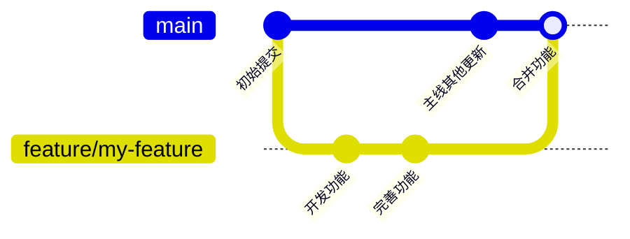
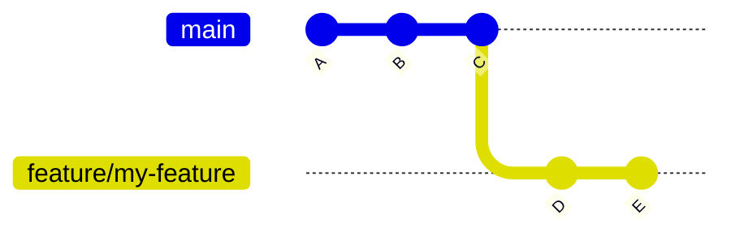
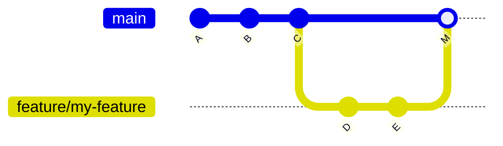
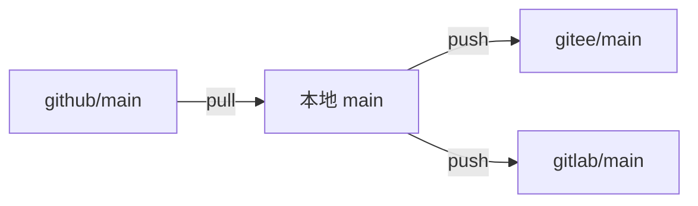

## 快速参考：日常命令

以 `feature/my-feature` 为例，下面是一套适合个人开发的简洁流程。假设 `github` 是主要用于 PR 的远程，`gitee` 和 `gitlab` 是同步副本。

```bash
# 1. 从 main 创建新功能分支
git switch main
git switch -c feature/my-feature

# 2. 开发并提交
git add .
git commit -m "feat: implement my feature"

# 3. 推送 feature 到主要远程
git push -u github feature/my-feature

# 4. 在 GitHub 上创建 PR：feature/my-feature -> main
#    检查代码并合并 PR

# 5. PR 合并后，将 GitHub 的 main 同步到本地
git switch main
git pull github main

# 6. 将更新后的 main 推送到其他远程
git push gitee main
git push gitlab main

# 7. 删除已合并的本地 feature 分支
git branch -d feature/my-feature

# 8. 删除其他远程上不再需要的 feature 分支（可选）
git push github --delete feature/my-feature
git push gitee --delete feature/my-feature
git push gitlab --delete feature/my-feature
```

> 先确认 PR 已合并、main 已同步，之后再清理分支。上面的远程名称和分支名称需按实际仓库调整。

## 1. 为什么使用 feature 分支？

`main` 作为主线，尽量保持在可运行、相对稳定的状态。开发新功能时，从 main 创建独立的 feature 分支，在该分支上修改、测试和提交；完成后再将变更合并回 main。

这种方式可以把尚未完成的工作隔离在主线之外，也便于逐个功能审查、回溯和撤销。

### 分支关系示意图



## 2. 创建与命名分支

先检查当前状态：

```bash
git status
git branch
```

如果 main 已同步且工作区状态适当，创建并切换到新分支：

```bash
git switch main
git switch -c feature/my-feature
```

`git switch -c` 等同于先用 `git branch` 创建分支，再用 `git switch` 切换过去。

### 分支命名

`feature/my-feature` 中的斜线 `/` 不是功能性语法，而是命名约定，方便按类别组织分支；`feature-my-feature` 也同样有效。采用斜线分组时，不应同时创建名称为 `feature` 的分支与 `feature/...` 分支，因为引用路径会冲突。

常见命名方式：

| 前缀 | 用途 | 示例 |
|---|---|---|
| `feature/` | 新功能 | `feature/new-layout` |
| `fix/` | Bug 修复 | `fix/navbar-bug` |
| `docs/` | 文档 | `docs/git-guide` |
| `refactor/` | 重构 | `refactor/theme-config` |
| `experiment/` | 实验 | `experiment/new-style` |

## 3. 在 feature 分支上开发和提交

切换到 feature 分支之后，正常修改项目文件。可以按开发阶段分成多次提交：

```bash
git add .
git commit -m "feat: add layout structure"

git add .
git commit -m "feat: implement responsive layout"

git add .
git commit -m "test: verify layout behavior"
```

每个 commit 都记录在当前分支的历史中。提交信息可采用简洁、清楚的格式，例如 `feat:`、`fix:`、`docs:` 等前缀。

## 4. 查看本地 Git 分支图

Git 自带图形化字符输出，无需安装工具：

```bash
git log --graph --oneline --decorate --all
```

也可以设置一个全局别名，之后使用 `git graph`：

```bash
git config --global alias.graph "log --graph --oneline --decorate --all"
```

VS Code 用户还可以安装 **Git Graph** 扩展，在界面中查看提交、分支、合并关系以及提交差异。

## 5. 将 feature 推送到远程

首次推送并建立上游关联：

```bash
git push -u github feature/my-feature
```

这里 `github` 是远程名称，`feature/my-feature` 是分支名；`-u`（`--set-upstream`）建立本地分支与远程跟踪分支的关联。之后在该分支上通常可以直接使用 `git push` 和 `git pull`。

如果希望多个远程都保存 feature 分支，可以分别推送：

```bash
git push gitee feature/my-feature
git push gitlab feature/my-feature
```

## 6. 合并 feature 到 main

开发完成并检查代码后，将 feature 合并到 main。合并命令会将指定分支合并到**当前所在分支**，所以先切换到 main：

```bash
git switch main
git merge feature/my-feature
```

### Fast-forward 合并

如果 main 在 feature 开发期间没有产生额外提交，Git 可能直接把 main 指针推进到 feature 的最新提交，这称为 Fast-forward：



```text
A -- B -- C -- D -- E
           ^         ^
          main     feature
```

合并后，main 也指向 E，不需要额外的合并提交。

### Non-fast-forward / Merge commit

如果 main 和 feature 都各自有新的提交，Git 通常会创建合并提交，记录两条历史的整合：



```text
          D -- E ----\
         /            \
A -- B -- C -- M -----+  main
         \
          (main 在 C 时的分支起点)
```

即使可以 Fast-forward，也可以使用 `--no-ff` 强制创建合并提交，以保留功能分支合并的可见记录：

```bash
git merge --no-ff feature/my-feature
```

是否使用 `--no-ff`，可以根据个人项目对历史呈现的偏好决定。

## 7. 合并冲突

当 main 和 feature 修改了同一文件的同一部分，Git 可能无法自动合并，会在文件中标记冲突，例如：

```text
<<<<<<< HEAD
main 中的内容
=======
feature 中的内容
>>>>>>> feature/my-feature
```

手动编辑文件，决定保留或整合哪些内容，删除冲突标记，然后：

```bash
git add <冲突文件>
git commit
```

如果决定放弃这次尚未完成的合并：

```bash
git merge --abort
```

冲突并不代表 Git 出错，而是需要开发者判断如何整合两边的修改。

## 8. Pull Request：个人也可以在同一个仓库发起 PR

Pull Request（PR）不是 Git 的命令，而是 GitHub、GitLab、Gitee 等平台提供的代码审查和合并工作流。PR 的核心是提出将一个分支的变更合并到另一个分支。

**个人开发者可以在同一个账户、同一个仓库中创建 PR。** 不需要另一个账户，也不需要 Fork 另一个仓库。

例如，同一个 GitHub 仓库有：

- `main`：目标分支（Base）
- `feature/my-feature`：来源分支（Head / Compare）

创建 PR 时选择：

```text
Base:    main
Compare: feature/my-feature
```

这表示请求将 feature 分支的变更合并到 main。你可以自己查看 Diff、修改 PR 描述、检查自动化测试，并在符合仓库规则的情况下自己合并。若仓库设置了必须由其他人批准的保护规则，则仍需满足规则。

### PR 对单人开发的价值

- **审查 Diff：** 合并前再检查具体改动。
- **保持主线稳定：** 未完成或未检查的功能不直接进入 main。
- **记录功能：** PR 标题、描述、提交和变更文件形成可回顾的记录。
- **自动化检查：** 可以在 PR 阶段运行测试、构建或 GitHub Actions 工作流。

## 9. PR 合并策略

平台通常提供不同合并策略，常见的有：

| 策略 | 说明 |
|---|---|
| Merge commit | 保留分支提交历史，并记录合并提交。 |
| Squash and merge | 将 feature 的多个提交压缩成一个提交再合并。 |
| Rebase and merge | 将提交整理到目标分支的历史序列中，通常不产生普通的 merge commit。 |

不同策略会形成不同的提交历史。对于多远程同步，尤其要注意：如果 GitHub 使用 Squash 或 Rebase Merge，远程 main 的历史可能与原本的 feature 提交历史不同。合并后应以主要平台的 main 为准，先同步到本地，再推送到其他远程，不要直接把旧 feature 分支推到其他远程的 main。

## 10. 多个远程仓库：在一个平台 PR，其他远程如何同步？

假设同一个本地项目有三个远程：

| 远程 | 角色 |
|---|---|
| `github` | 主开发平台，创建 PR、审查和合并 |
| `gitee` | 同步副本 |
| `gitlab` | 同步副本 |

在 GitHub 上合并 PR，只会更新 GitHub 上对应的分支；不会自动更新 Gitee 或 GitLab。

推荐以 GitHub 为主要合并平台。PR 合并之后：

```bash
# 切换到本地 main
git switch main

# 将 GitHub 上合并后的 main 同步到本地
git pull github main

# 推送同步后的 main 到其他远程
git push gitee main
git push gitlab main
```

完成后，三个远程的 main 就可以同步到同一个合并结果。



```text
本地 main  <--- pull --- github/main (PR 已合并)
   |
   +---- push ----> gitee/main
   |
   +---- push ----> gitlab/main
```

### 是否要在三个平台分别创建 PR？

可以分别创建 PR，但个人开发通常没有必要。每个平台都创建 PR 会增加审查、合并和历史管理的成本。

更简单的策略是：

- 选一个平台作为主开发平台，集中创建 PR 和合并。
- 其他远程作为同步副本。
- PR 合并后，先同步主平台的 main 到本地，再推送到其他远程。

## 11. 合并后清理分支

合并完成并确认 main 已同步之后，可以删除本地 feature 分支：

```bash
git branch -d feature/my-feature
```

如果远程 feature 分支也不再需要，可以分别删除：

```bash
git push github --delete feature/my-feature
git push gitee --delete feature/my-feature
git push gitlab --delete feature/my-feature
```

删除分支引用并不会删除已经合并到 main 的提交历史。`git branch -d` 是较安全的删除方式：如果 Git 判断分支尚未合并，通常会拒绝删除。

## 12. 总结

对于个人开发项目，推荐采用简单的 **main + feature 分支 + Pull Request** 工作流：

1. `main` 保持相对稳定。
2. 每个新功能创建独立的 `feature/...` 分支。
3. 在 feature 上开发、测试并提交。
4. 将 feature 推送到主要远程。
5. 创建 PR，检查 Diff 后合并到 main。
6. PR 合并后，先将主要远程的 main 拉取到本地。
7. 将同步后的 main 推送到其他远程。
8. 删除已完成的 feature 分支。

这种模式不需要复杂的 Git Flow，也不需要额外的长期 `develop` 分支，适合个人项目、开源主题和小型代码库。