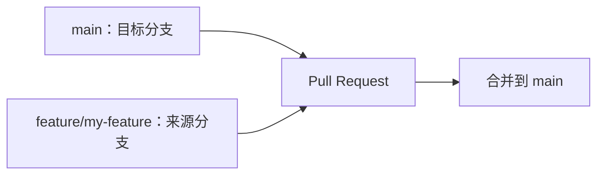
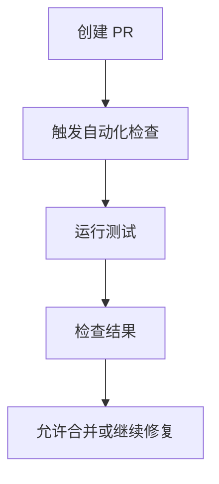
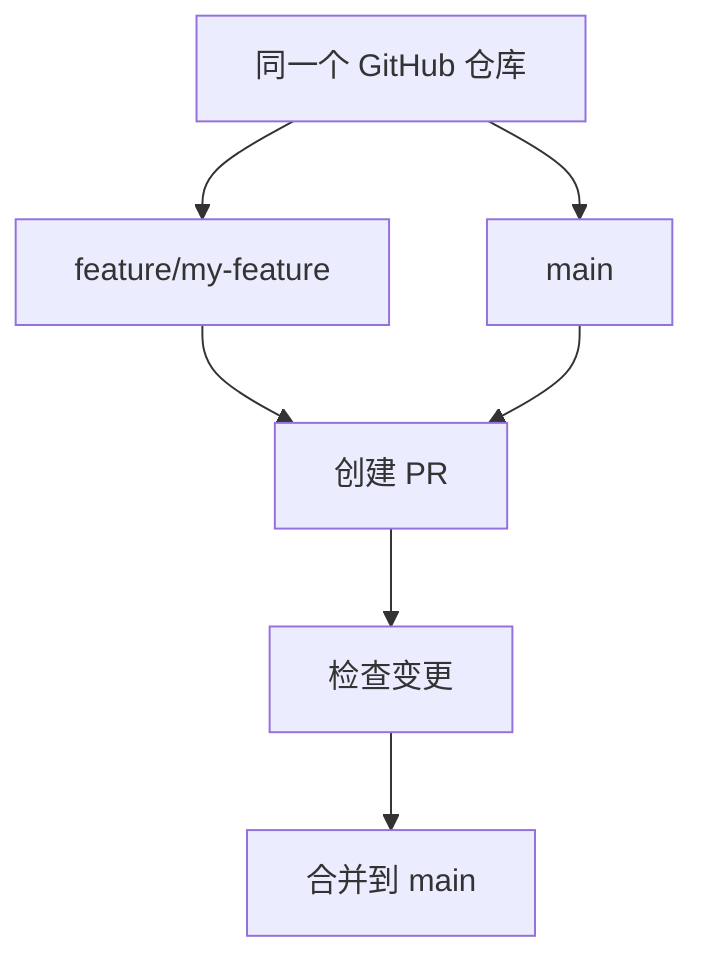
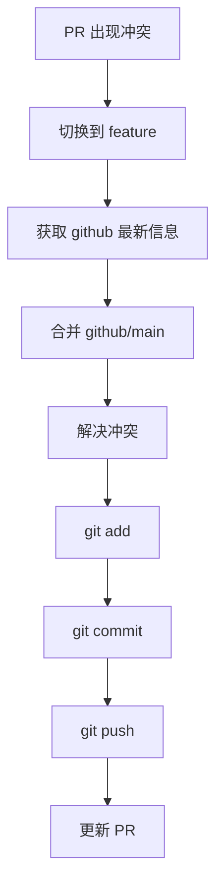
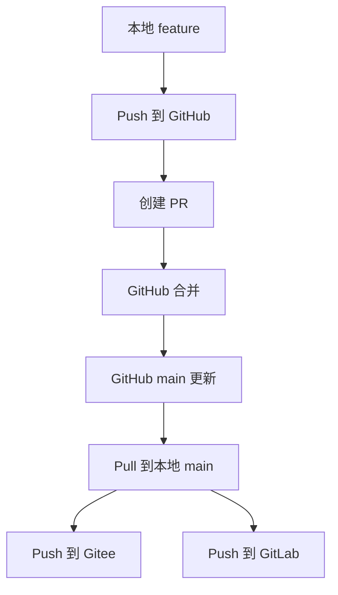
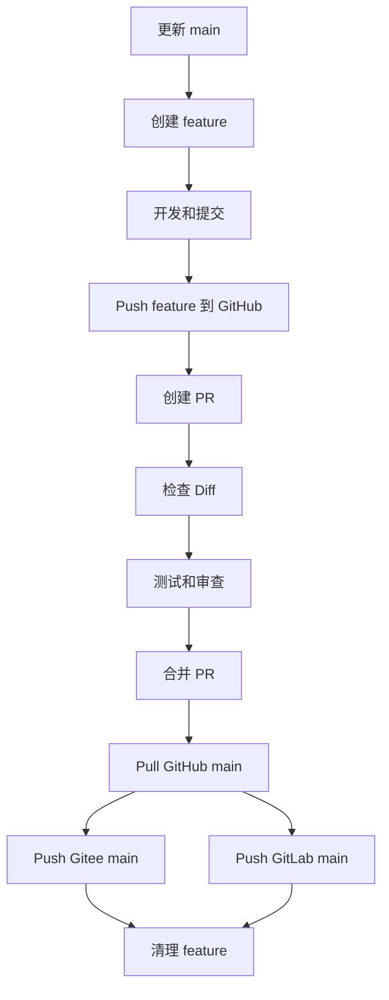

# Git Pull Request 实战：从创建到合并

## 日常命令速查

假设我们使用 GitHub 作为主要的 PR 平台，功能分支为 `feature/my-feature`。

```bash
# 1. 更新主分支
git switch main
git pull github main

# 2. 创建功能分支
git switch -c feature/my-feature

# 3. 开发并提交
git add .
git commit -m "feat: implement my feature"

# 4. 推送功能分支
git push -u github feature/my-feature

# 5. 在 GitHub 创建 PR
#    Base: main
#    Compare: feature/my-feature

# 6. PR 合并完成后更新本地 main
git switch main
git pull github main

# 7. 同步其他远程
git push gitee main
git push gitlab main

# 8. 删除本地功能分支
git branch -d feature/my-feature

# 9. 删除远程功能分支（可选）
git push github --delete feature/my-feature
```

> 本文假设 `github` 是主要的 PR 和合并平台，`gitee`、`gitlab` 是用于同步的其他远程仓库。

---

## 1. 什么是 Pull Request？

Pull Request，通常简称 PR，是 GitHub 等代码托管平台提供的一种代码审查和代码整合机制。

当我们在一个分支上完成开发，希望将这些修改整合到另一个分支时，可以创建 Pull Request。

例如：

```text
main
  |
  +-- feature/my-feature
```

我们在 `feature/my-feature` 中完成了功能开发，希望将其合并到 `main`。

这时可以创建 PR：

```text
feature/my-feature
       |
       v
   Pull Request
       |
       v
      main
```

PR 的主要作用：

- 展示两个分支之间的差异。
- 让其他开发者审查代码。
- 讨论代码实现。
- 检查提交记录。
- 运行自动化测试。
- 将修改整合到目标分支。

### PR 是 Git 命令吗？

不是。

Git 本身提供分支、提交、合并等功能。

Pull Request 则是 GitHub、GitLab 等平台提供的协作流程。

Git 中的基础操作包括：

```bash
git branch
git switch
git commit
git merge
git push
```

PR 通常是在 GitHub 网站上完成创建、审查和合并。

---

## 2. Pull Request 的基本原理

PR 通常涉及两个分支：

- Base：目标分支。
- Compare / Head：来源分支。

例如：

```text
Base:      main
Compare:   feature/my-feature
```

这表示我们希望将 `feature/my-feature` 中的修改整合到 `main`。

### PR 的方向



纯文本：

```text
feature/my-feature
        |
        |
        v
   Pull Request
        |
        v
       main
```

PR 不是简单地把代码上传到服务器，而是提供一个专门的整合过程。

在 PR 合并之前，来源分支和目标分支仍然是独立的分支。

---

## 3. 为什么要使用 Pull Request？

即使是个人开发者，也可以使用 PR。

PR 不仅仅是多人协作的工具，它也可以作为一个开发检查环节。

### 3.1 检查代码变更

开发过程中，我们可能会：

- 修改错误的文件。
- 遗漏某些修改。
- 不小心删除内容。
- 引入不必要的代码。
- 修改与当前任务无关的部分。

PR 可以让我们在合并之前检查完整的变更。

### 3.2 查看代码差异

PR 通常会展示：

```text
文件名称
   |
   +-- 新增的代码
   +-- 删除的代码
   +-- 修改的代码
```

我们可以逐个文件检查。

### 3.3 记录开发过程

PR 可以保存：

- 功能说明。
- 修改目的。
- 讨论记录。
- 测试结果。
- 代码审查意见。
- 合并记录。

这使得 PR 成为一种项目记录。

### 3.4 自动化测试

GitHub 可以通过 Actions 等 CI 工具自动运行测试。

例如：



PR 可以在合并前发现部分问题。

---

## 4. 个人开发者如何创建 PR？

PR 不要求必须有多个开发者，也不要求使用 Fork。

个人开发者完全可以在自己的同一个仓库中创建 PR。

例如：

```text
GitHub 仓库：my-project

分支：
├── main
└── feature/my-feature
```

我们在 `feature/my-feature` 上开发，完成后创建 PR：

```text
feature/my-feature
        |
        v
  创建 Pull Request
        |
        v
  Base: main
  Compare: feature/my-feature
        |
        v
  检查变更
        |
        v
      Merge
        |
        v
       main
```

### 同一个仓库中的 PR



纯文本：

```text
同一个仓库

main
  |
  +--------------------------+
                             |
feature/my-feature           |
  |                          |
  +---- Pull Request ---------+
               |
               v
             Merge
               |
               v
              main
```

这是一种非常适合个人开发的方式。

---

## 5. 创建 Pull Request 的完整过程

### 第一步：更新主分支

在创建新功能之前，先更新主分支：

```bash
git switch main
git pull github main
```

这可以减少基于过旧主分支开发的风险。

### 第二步：创建功能分支

```bash
git switch -c feature/my-feature
```

### 第三步：开发并提交

修改项目文件：

```bash
git add .
git commit -m "feat: implement my feature"
```

如果有多个开发阶段，可以进行多次提交：

```bash
git add .
git commit -m "feat: add initial implementation"

git add .
git commit -m "fix: correct implementation"

git add .
git commit -m "docs: update documentation"
```

### 第四步：推送功能分支

```bash
git push -u github feature/my-feature
```

这一步将本地功能分支上传到 GitHub。

如果是第一次推送，`-u` 会建立本地分支和远程分支之间的跟踪关系。

### 第五步：创建 PR

打开 GitHub 仓库。

通常可以在仓库页面看到：

- Pull requests
- New pull request

点击 New pull request。

选择：

```text
Base:      main
Compare:   feature/my-feature
```

确认方向正确。

### 第六步：填写 PR 信息

PR 通常包含：

- 标题。
- 描述。
- 修改内容。
- 测试情况。
- 关联 Issue（如果有）。

例如：

```text
Title:

Add dark mode support

Description:

This PR adds dark mode support to the theme.

Changes:
- Add dark mode styles
- Add theme toggle
- Update settings

Testing:
- Tested in Chrome
- Tested on mobile layout
```

### 第七步：检查 Diff

创建 PR 后，重点检查：

- 修改了哪些文件？
- 新增了哪些内容？
- 删除了哪些内容？
- 是否有意外修改？
- 是否有明显错误？
- 是否完成测试？

### 第八步：合并 PR

确认修改符合预期后，选择合并方式并执行 Merge。

合并后，目标分支 `main` 就包含了功能分支的修改。

---

## 6. PR 中的 Base 和 Compare

在 GitHub 创建 PR 时，最重要的是理解 Base 和 Compare。

### Base

Base 是目标分支。

也就是希望将修改合并到哪个分支。

例如：

```text
Base: main
```

### Compare

Compare 是来源分支。

它包含我们希望整合到 Base 中的修改。

例如：

```text
Compare: feature/my-feature
```

### 正确的方向

```text
Base:      main
Compare:   feature/my-feature
```

意味着：

```text
feature/my-feature
          |
          v
         main
```

### 如果选择反了会怎样？

例如：

```text
Base:      feature/my-feature
Compare:   main
```

这表示平台会比较 `main` 相对于 `feature/my-feature` 的差异，并准备将 `main` 的修改合入功能分支。

这通常不是我们想要的方向。

创建 PR 时，务必检查 Base 和 Compare。

---

## 7. PR 合并策略

GitHub 通常提供几种合并方式。

### 7.1 Merge commit

保留功能分支的提交历史，并创建一个合并提交。

```text
main:      A---B-------M
               \      /
feature:        C---D
```

合并提交 `M` 记录了两条历史的整合。

优点：

- 保留分支开发过程。
- 可以清楚看到合并节点。
- 历史结构比较完整。

缺点：

- 提交历史可能变得更复杂。
- 合并提交数量可能较多。

### 7.2 Squash and merge

将功能分支的多个提交压缩成一个提交，再合入主分支。

```text
feature:   C---D---E
             |
          多个提交

main:      A---B---S
                  |
               一个提交
```

这里的 `S` 是压缩后的提交。

优点：

- 主分支历史简洁。
- 功能通常对应一个主线提交。
- 不会保留功能分支上的每个独立提交。

缺点：

- 功能分支上的原始提交结构不会以原样出现在主分支历史中。
- 之后继续复用已 Squash 合并的分支时，需要注意历史关系。

### 7.3 Rebase and merge

将功能分支的提交重新应用到目标分支的最新提交之后。

示意：

```text
原始历史：

main:      A---B
               \
feature:        C---D
```

Rebase 后：

```text
main:      A---B---C'---D'
```

`C'`、`D'` 是重新生成的提交，通常与原始 `C`、`D` 的提交 ID 不同。

优点：

- 主线历史比较直线。
- 不需要保留传统的合并节点。

缺点：

- 会改变提交历史。
- 对已经共享的提交历史进行 Rebase 需要谨慎。

### 三种策略比较

| 合并方式 | 主线历史 | 是否保留分支合并节点 |
|---|---|---|
| Merge commit | 保留分叉和整合结构 | 是 |
| Squash and merge | 功能通常压缩为一个提交 | 否 |
| Rebase and merge | 重新排列为较直线的历史 | 通常否 |

对于个人项目：

- 想保留完整的分支开发过程，可以使用 Merge commit。
- 想让主分支历史简洁，可以使用 Squash and merge。
- 希望提交历史更直线，可以考虑 Rebase and merge。

---

## 8. PR 中的冲突如何处理？

PR 可能出现冲突。

例如：

```text
main:      A---B---X
               \
feature:        C---Y
```

如果主分支和功能分支修改了相同内容，Git 可能无法自动合并。

GitHub 会显示类似：

```text
This branch has conflicts that must be resolved.
```

### 8.1 在本地解决冲突

先切换到功能分支：

```bash
git switch feature/my-feature
```

获取远程最新信息：

```bash
git fetch github
```

将远程主分支合并到功能分支：

```bash
git merge github/main
```

如果发生冲突，Git 会提示需要处理的文件。

### 8.2 查看冲突

```bash
git status
```

打开冲突文件，可能看到：

```text
<<<<<<< HEAD
功能分支当前内容
=======
main 分支中的内容
>>>>>>> github/main
```

这里的 `HEAD` 是当前所在分支的版本。

在这个例子中，当前所在的是 `feature/my-feature`，所以 `HEAD` 对应功能分支。

### 8.3 解决冲突

人工编辑文件：

- 保留功能分支内容。
- 保留主分支内容。
- 或者将两部分内容结合起来。

然后删除冲突标记。

### 8.4 提交解决结果

```bash
git add .
git commit
```

### 8.5 推送更新

```bash
git push github feature/my-feature
```

GitHub 上的 PR 会更新。

### 冲突解决流程



纯文本：

```text
PR 冲突
   |
   v
切换 feature
   |
   v
fetch 远程
   |
   v
merge 远程 main
   |
   v
解决冲突
   |
   v
add + commit
   |
   v
push feature
   |
   v
PR 更新
```

---

## 9. PR 合并之后，如何同步其他远程仓库？

假设我们使用三个远程仓库：

```text
github
gitee
gitlab
```

GitHub 是主要的 PR 平台。

Gitee 和 GitLab 用于同步。

### 9.1 PR 合并只会更新 GitHub

当我们在 GitHub 上合并 PR 时：

```text
GitHub main
```

会更新。

但：

```text
Gitee main
GitLab main
```

不会自动更新。

### 9.2 同步流程



纯文本：

```text
本地 feature
      |
      v
  Push GitHub
      |
      v
  创建 PR
      |
      v
 GitHub Merge
      |
      v
GitHub main 更新
      |
      v
本地 main pull
      |
      +----> Push Gitee
      |
      +----> Push GitLab
```

### 9.3 同步命令

PR 合并完成后：

```bash
git switch main
git pull github main
```

将 GitHub 上已经合并的主分支同步到本地。

然后：

```bash
git push gitee main
git push gitlab main
```

这样就将主分支更新同步到其他远程仓库。

### 9.4 为什么不直接将功能分支推到其他远程的 main？

如果 PR 尚未合并，我们不应该随意将未经整合的功能分支直接推送到其他远程的主分支。

这样可能导致：

- 主分支内容不一致。
- 提交历史不一致。
- 其他远程主分支提前包含未完成内容。
- 后续同步产生复杂问题。

更简单的方式是：

```text
GitHub PR 合并
       |
       v
GitHub main
       |
       v
同步到本地 main
       |
       v
同步到其他远程 main
```

将 GitHub 作为主要的整合平台，其他远程作为同步副本。

---

## 10. 合并后删除功能分支

PR 合并完成后，通常可以删除功能分支。

### 10.1 删除本地分支

```bash
git branch -d feature/my-feature
```

### 10.2 删除远程分支

```bash
git push github --delete feature/my-feature
```

如果其他远程也存在该功能分支：

```bash
git push gitee --delete feature/my-feature
git push gitlab --delete feature/my-feature
```

### 10.3 GitHub 上删除来源分支

GitHub 在 PR 合并完成后，通常会提供删除来源分支的操作。

如果使用该选项，GitHub 上的功能分支就会被删除。

但本地分支仍然需要单独清理：

```bash
git branch -d feature/my-feature
```

---

## 11. 个人开发者的完整 PR 工作流

假设我们有：

```text
main
feature/my-feature
```

并且：

```text
github：主要 PR 平台
gitee：同步远程
gitlab：同步远程
```

### 完整流程



纯文本：

```text
更新 main
   |
   v
创建 feature
   |
   v
开发、提交
   |
   v
Push GitHub
   |
   v
创建 PR
   |
   v
检查 Diff
   |
   v
测试和审查
   |
   v
Merge
   |
   v
Pull GitHub main
   |
   +----> Push Gitee
   |
   +----> Push GitLab
   |
   v
清理 feature
```

### 命令汇总

```bash
# 更新主分支
git switch main
git pull github main

# 创建功能分支
git switch -c feature/my-feature

# 开发并提交
git add .
git commit -m "feat: implement my feature"

# 推送功能分支
git push -u github feature/my-feature

# 在 GitHub 创建 PR
# Base: main
# Compare: feature/my-feature

# PR 合并完成后
git switch main
git pull github main

# 同步其他远程
git push gitee main
git push gitlab main

# 删除本地功能分支
git branch -d feature/my-feature

# 删除远程功能分支
git push github --delete feature/my-feature
```

---

## 总结

Pull Request 是代码整合、审查和记录的一种工作流程。

对于个人开发者，PR 同样具有价值。

它可以帮助我们：

1. 将开发与整合分开。
2. 在合并前检查修改。
3. 查看代码差异。
4. 记录开发过程。
5. 运行自动化测试。
6. 保持主分支相对稳定。

个人项目不需要复杂的协作结构，也不需要 Fork 或第二个账号。

一个仓库、一个 `main` 分支、一个功能分支，就可以完整使用 PR 工作流。

对于同时维护 GitHub、Gitee 和 GitLab 的个人开发者，可以采用：

- GitHub：主要开发和 PR 合并平台。
- Gitee：同步仓库。
- GitLab：同步仓库。

PR 合并后，先更新本地 `main`，再推送到其他远程仓库。

这是一种简单、清晰且容易维护的个人开发流程。
