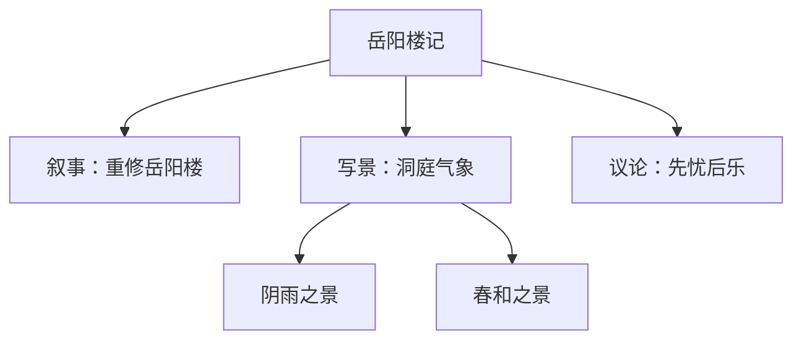

本文节选自范仲淹《岳阳楼记》，用于演示标题层级、段落、引用、列表、表格、流程图与图片等特性。

## 第一段 · 叙事

> 庆历四年春，滕子京谪守巴陵郡。越明年，政通人和，百废俱兴，乃重修岳阳楼，增其旧制，刻唐贤今人诗赋于其上。属予作文以记之。

## 第二段 · 写景

予观夫巴陵胜状，在洞庭一湖：

1. **衔远山，吞长江**，浩浩汤汤，横无际涯；
2. 朝晖夕阴，气象万千，此则岳阳楼之大观也。

至若春和景明，波澜不惊，上下天光，一碧万顷。——这既是写景，也是作者心境的映照。

---

## 重点字词对照

| 词 | 释义 | 例句 |
|----|------|------|
| 谪守 | 因罪被贬而任地方官 | 滕子京谪守巴陵郡 |
| 属 | 同「嘱」，嘱咐 | 属予作文以记之 |
| 浩浩汤汤 | 水势浩大 | 浩浩汤汤，横无际涯 |

## 文章结构图（Mermaid 流程图）

## 图片演示（render-image）

## 扩展阅读

- 相关链接（render-link）：[Hugo 官方文档](https://gohugo.io/)
- 英文对译版：`en/posts/guwen-yueyanglou.md`