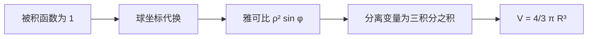

# 三重积分：球坐标法推导球体体积

本页演示数学公式（KaTeX：行内与块级）如何在示例内容中呈现。

## 问题设定与变量代换

设球体 $B = \{ (x,y,z) : x^2 + y^2 + z^2 \le R^2 \}$。改用球坐标：

$$
x = \rho\sin\varphi\cos\theta,\quad
y = \rho\sin\varphi\sin\theta,\quad
z = \rho\cos\varphi
$$

其中 $\rho \in [0, R]$、$\varphi \in [0, \pi]$、$\theta \in [0, 2\pi]$，雅可比行列式为 $\rho^2\sin\varphi$。

该球体的体积可由「对 1 作三重积分」求得：

$$
V = \iiint_{B} 1\,dV
   = \int_0^{2\pi}\int_0^{\pi}\int_0^{R}\rho^2\sin\varphi\,
     d\rho\,d\varphi\,d\theta
$$

## 逐层分离（可分离变量）

由于被积函数可分离，三重积分化为三个一重积分之积：

$$
\begin{aligned}
V
&= \left(\int_0^{2\pi} d\theta\right)
   \left(\int_0^{\pi}\sin\varphi\, d\varphi\right)
   \left(\int_0^{R}\rho^2\, d\rho\right)\\
&= (2\pi)(2)\left(\frac{R^3}{3}\right)
   = \frac{4}{3}\pi R^3
\end{aligned}
$$

因此球体积公式为

$$
V = \frac{4}{3}\pi R^3 \quad \checkmark
$$

## 推导流程（Mermaid 流程图）



## 数值验证（Python 代码块）

```python
import numpy as np
from scipy import integrate

R = 1.0
f = lambda z, y, x: 1.0

# 在球体范围内对 1 作数值三重积分
volume, _ = integrate.tplquad(
    f,
    -R, R,
    lambda x: -np.sqrt(R**2 - x**2),      lambda x: np.sqrt(R**2 - x**2),
    lambda x, y: -np.sqrt(R**2 - x**2 - y**2),
    lambda x, y:  np.sqrt(R**2 - x**2 - y**2),
)
print(volume)            # 4.18879...
print(4 / 3 * np.pi * R**3)   # 4.18879...  二者一致
```